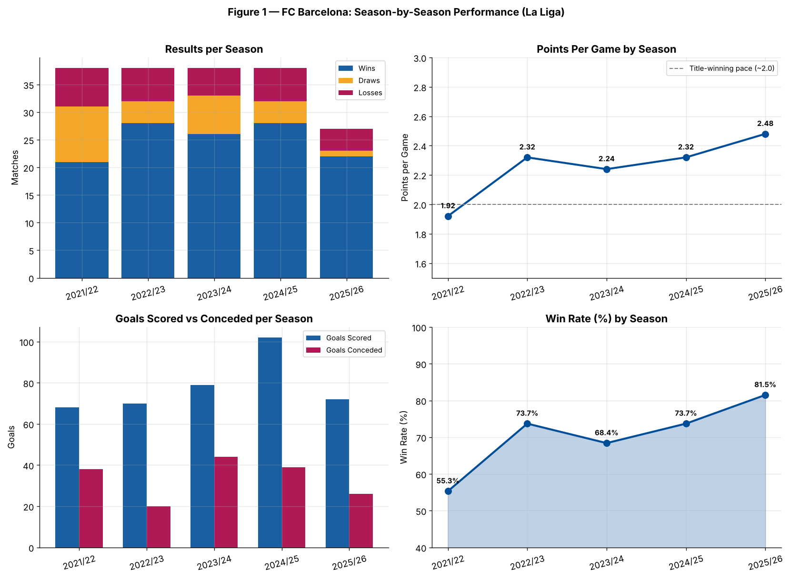
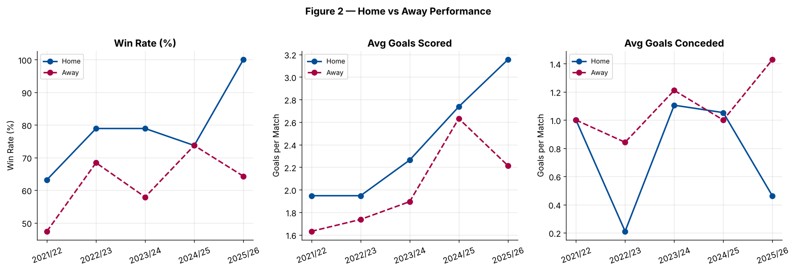
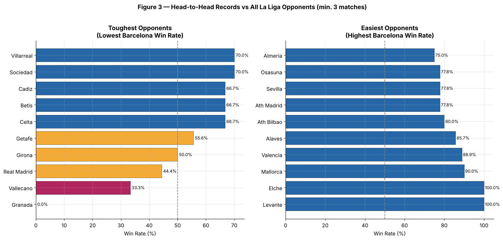
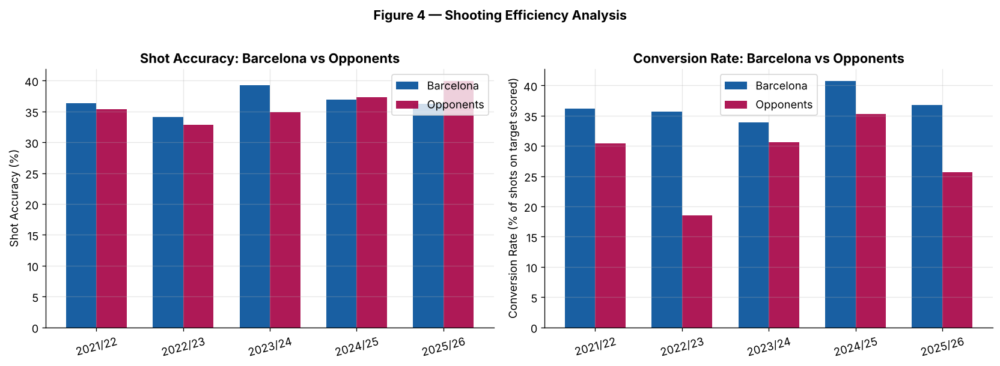
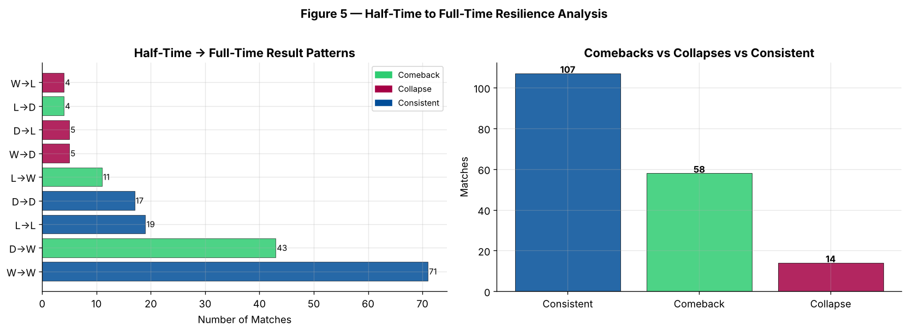
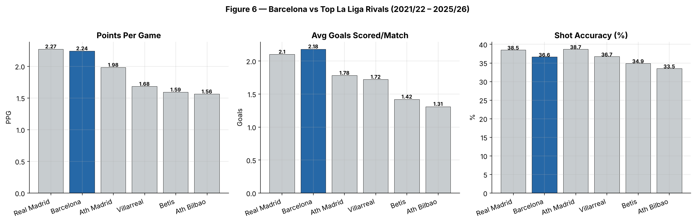

# ⚽ FC Barcelona: La Liga Performance Analysis (2021/22 – 2025/26)

> Exploratory analysis of FC Barcelona's league performance across five seasons: results, home advantage, toughest opponents, finishing efficiency, second-half resilience, and how they compare with La Liga's other leading clubs.


**Data:** 1,790 La Liga matches from Football-Data.co.uk, of which **179 involve Barcelona**. Four complete seasons plus 2025/26 up to 9 March 2026.

---

## 📌 Key findings

| # | Question | Answer |
|---|---|---|
| 1 | How consistent has Barcelona been? | **1st** in 2022/23 and 2024/25, **2nd** in 2021/22 and 2023/24, and **leading 2025/26** after 27 matches. Points per game rose from **1.92 → 2.48**. |
| 2 | How big is the home advantage? | **77.5%** win rate at home vs **62.2%** away (2.40 vs 2.08 points per game). Higher at home in four of five seasons. |
| 3 | Who is the toughest opponent? | **Real Madrid**: 4 wins, 5 losses in 9 league meetings (1.33 points per game). |
| 4 | How efficient is the attack? | 16.2 shots per game, **37.0%** on target, **37.5%** of shots on target converted. |
| 5 | Do they turn games around? | Improved their half-time result in **58** matches, lost ground in only **14**. Trailing at half-time 34 times, they still won 11. |
| 6 | How do they compare with rivals? | The **most goals per game** of the leading clubs (2.18), but Real Madrid edged them on points per game (**2.27 vs 2.24**). |

---

## 📊 Charts

**Season by season.** Points per game climbed after a weaker 2021/22.



**Home vs away.** Home win rate was higher in four of five seasons (level in 2024/25), and Barcelona have won every home league match of 2025/26 so far.



**Head-to-head.** Win rates against every opponent faced at least 3 times.



**Shooting efficiency.** Shots, accuracy and conversion by season.



**Half-time resilience.** How half-time positions turned into full-time results.



**Rivals comparison.** Barcelona vs La Liga's other leading clubs.



---

## 🗂️ Repository structure

```
barcelona-performance-analysis/
├── barcelona_analysis.ipynb      # full analysis
├── SP1_21.csv                    # La Liga 2021/22
├── SP1_22.csv                    # La Liga 2022/23
├── SP1_23.csv                    # La Liga 2023/24
├── SP1_24.csv                    # La Liga 2024/25
├── SP1_25.csv                    # La Liga 2025/26 (to 9 March 2026)
├── fig1_season_performance.png … fig6_rivals_comparison.png
├── requirements.txt
└── README.md
```

File names follow the year each season **starts**: `SP1_21.csv` holds the 2021/22 season (first match 13 August 2021).

## ▶️ How to run

```bash
git clone https://github.com/abir110/barcelona-performance-analysis.git
cd barcelona-performance-analysis
pip install -r requirements.txt
jupyter lab barcelona_analysis.ipynb
```

## 🛠️ Tools

Python · pandas · NumPy · Matplotlib · Seaborn · Jupyter

## 📚 Data source

[Football-Data.co.uk, La Liga results and statistics (SP1)](https://www.football-data.co.uk/spainm.php). Free and publicly available. Includes results, half-time scores, shots, shots on target, corners, fouls, cards and betting odds.

## ⚠️ Notes and limitations

- League positions are computed from the match data (points, then goal difference). La Liga's official tie-breaker is head-to-head, but no season here was decided by a tie.
- 2025/26 is incomplete, so its figures will change as the season continues.
- "Comeback" counts any improvement from half-time to full-time (draw → win, loss → draw, loss → win).

---

**Author:** Abir Alam Srabon · MSc Data Science, Aston University · [LinkedIn](https://www.linkedin.com/in/abir-alam-srabon) · [GitHub](https://github.com/abir110) · [Portfolio](https://abir110.github.io)
